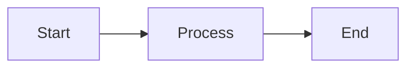

Hextra is a modern Hugo theme for documentation and blogs. Beyond standard Markdown, it ships with a rich set of shortcodes to enhance your content. This post covers the most useful ones with syntax and live rendered examples.

<!--more-->

---

## Collapsible Content (details)

Use to hide/show a block of content. Great for FAQ, supplementary notes, and long code snippets.

### Expanded by Default

{}
This is expanded by default. It supports **Markdown**, including `code`, links, and lists.
{}

````markdown
{}
This is expanded by default. It supports **Markdown**.
{}
````

### Collapsed by Default

{}
This is hidden by default. Click the title to reveal.
{}

````markdown
{}
This is hidden by default.
{}
````

> [!NOTE]
> Use `{}` delimiters (percent sign), otherwise Markdown inside won't render.

---

## Callouts

Use to display eye-catching notices within your content.

### Default (Orange)


This is a default callout.


```markdown

  This is a default callout.

```

### Info (Blue)


This is an info callout, for supplementary information.


```markdown

  This is an info callout, for supplementary information.

```

### Warning (Yellow)


This is a warning callout. Pay attention.


```markdown

  This is a warning callout. Pay attention.

```

### Error (Red)


This is an error callout. Dangerous operation.


```markdown

  This is an error callout. Dangerous operation.

```

### Custom Emoji


Use any emoji as the icon.


```markdown

  Use any emoji as the icon.

```

---

## GitHub-Style Alerts

Similar to callouts, but with lighter Markdown-only syntax.

> [!NOTE]
> Supplementary info (blue).

> [!TIP]
> Helpful suggestion (green).

> [!IMPORTANT]
> Key information (purple).

> [!WARNING]
> Caution needed (amber).

> [!CAUTION]
> Dangerous operation (red).

```markdown
> [!NOTE]
> Supplementary info (blue).

> [!TIP]
> Helpful suggestion (green).
```

**When to use:** Custom emoji → `callout`; simple labels → Alerts.

---

## Tabs

Use to display parallel content, such as multi-language code or platform-specific steps.


  
  ```json
  { "hello": "world" }
  ```
  
  
  ```yaml
  hello: world
  ```
  
  
  ```toml
  hello = "world"
  ```
  


````markdown

  
  ```json
  { "hello": "world" }
  ```
  
  
  ```yaml
  hello: world
  ```
  
  
  ```toml
  hello = "world"
  ```
  

````

Default selects the first tab. Use `defaultIndex="1"` to select the second.

---

## Card Grid (cards + card)

Use for post recommendations, resource lists, and feature showcases. Supports icons, images, and tags.


  
  


```markdown

  
  

```

With tags:


  
  


```markdown


```

---

## Steps

Use for tutorials, installation guides, and step-by-step instructions.

{}

### Step 1
Install Hugo: `brew install hugo` (macOS) or `choco install hugo` (Windows).

### Step 2
Create a site: `hugo new site myblog`

### Step 3
Choose a theme and deploy.

{}

````markdown
{}
### Step 1
Install Hugo: `brew install hugo` (macOS) or `choco install hugo` (Windows).

### Step 2
Create a site: `hugo new site myblog`

### Step 3
Choose a theme and deploy.
{}
````

> [!NOTE]
> Each step must be an H3 (`###`) header. Use `{}` delimiters.

---

## Enhanced Code Blocks

Add `{filename="filename"}` after the language tag to display a filename label.

```python {filename="app.py"}
def hello():
    print("Hello, world!")
```

````markdown
```python {filename="app.py"}
def hello():
    print("Hello, world!")
```
````

---

## Mermaid Diagrams

Write Mermaid syntax in a code block to render SVG diagrams.



````markdown

````

---

## File Tree (filetree)

Use to display directory structures. Folders can be expanded/collapsed.


  
    
    
      
      
    
  


```markdown

  
    
    
      
    
  

```

`state`: `"open"` (default) or `"closed"`.

---

## Inline Badges

Small inline labels with 4 color variants.

Default: 
Info: 
Warning: 
Error: 

```markdown




```

With link and icon:



```markdown

```

---

## Inline Icons

Insert Heroicons inline with text.

 GitHub,  Academic,  Edit

```markdown
 GitHub
```

> [!NOTE]
> Requires `enableInlineShortcodes: true` in site config.

---

## PDF Embed

Embeds a PDF viewer in an iframe.

```markdown

```

Supports remote URLs and local file paths (in page bundles).

---

## Jupyter Notebook

Renders `.ipynb` files inline with syntax-highlighted code cells, Markdown cells, and image output.

```markdown
{}
```

Uses `{}` delimiters. Supports remote URLs.

---

## Quick Reference

| Need | Shortcode | Delimiter |
|------|-----------|-----------|
| Collapsible text | `details` | `{}` |
| Callout | `callout` | `` |
| Tabs | `tabs` + `tab` | `` |
| Steps | `steps` | `{}` |
| Card grid | `cards` + `card` | `` |
| File tree | `filetree/*` | `` |
| Embed PDF | `pdf` | `` |
| Embed Notebook | `jupyter` | `{}` |
| Inline icon | `icon` | `` |
| Badge | `badge` | `` |
| Diagrams | Mermaid | ` ```mermaid ` |
| Code with filename | Code block attr | ` ```lang {filename="..."} ` |

---

For full parameter reference, see the [Hextra Shortcodes Documentation](https://imfing.github.io/hextra/docs/guide/shortcodes/).


**AI disclosure**: This article was written by the author with assistance from Claude (Anthropic) for drafting, bilingual translation, and formatting. The author has reviewed all content and takes full responsibility for its accuracy.

